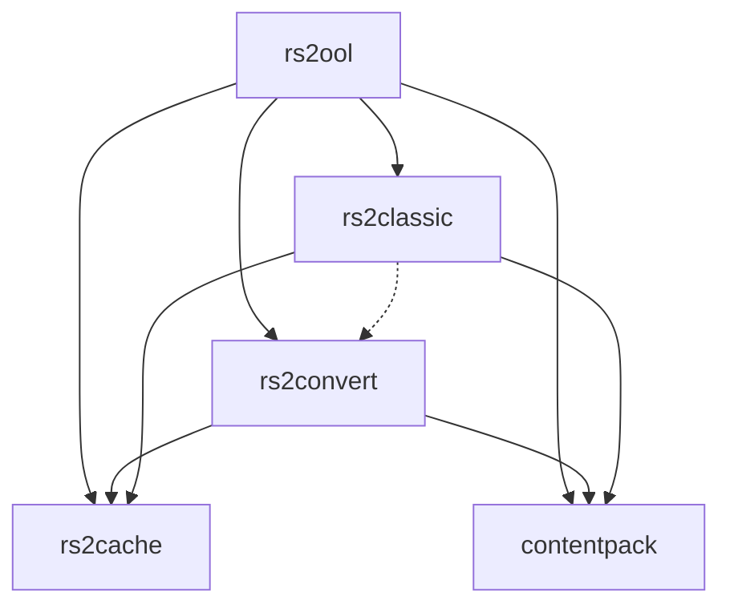

[Home](../README.md) › Crates

# Crates

The workspace is five crates: four libraries and one binary. This page lists them, shows how they depend on each other, and links to a page per crate.

All crates use Rust edition 2024 and share one `Cargo.lock`. The workspace manifest is [`Cargo.toml`](../../Cargo.toml); each crate's manifest is `crates/<name>/Cargo.toml`.

## The crates

| Crate | Kind | What it does | Page |
| --- | --- | --- | --- |
| `rs2cache` | library | Reads the 317 cache: index files, sector chains, jag archives, and a decoder for every record type. Decoded records are plain `serde` structs in `rs2cache::types`. | [rs2cache](rs2cache.md) |
| `contentpack` | library | The pack container (writer and reader), the encoders and decoders for every pack record, the HSL colour helpers, and loose record directories. | [contentpack](contentpack.md) |
| `rs2convert` | library | Turns decoded cache records into pack records: palette, models, creatures, rig inference, clips, validation, textures, sprites, floors and objects. | [rs2convert](rs2convert.md) |
| `rs2classic` | library | A software renderer that reimplements the original client's model renderer, drawing into a plain pixel buffer. | [rs2classic](rs2classic.md) |
| `rs2ool` | binary and library | The `rs2ool` command line (`rs2ool cache …`, `rs2ool pack …`) and, behind the default `explorer` feature, the GUI explorer. Sequence captioning is behind the default `caption` feature. | [rs2ool](rs2ool.md) |

## Dependency graph

Arrows point from a crate to the workspace crates it depends on. These are the `[dependencies]` in each `Cargo.toml`; the dashed edge is a dev-dependency only.

`rs2cache` and `contentpack` don't depend on any other workspace crate, or on each other. That keeps the cache side and the pack side independent: you can read a cache without the pack format, and read or write packs without a cache.

`rs2classic` takes models from `rs2cache::types` and the HSL-to-RGB table and brightness curve from `contentpack::palette`. It depends on `rs2convert` only in its tests.

## Third-party dependencies

| Crate | Notable dependencies |
| --- | --- |
| `rs2cache` | `memmap2`, `flate2` (gzip), `bzip2`, `crc32fast`, `serde`, `thiserror`, `tracing` |
| `contentpack` | `zstd`, `sha2`, `crc32fast`, `serde`, `serde_json`, `thiserror` |
| `rs2convert` | `glam`, `rayon`, `crc32fast`, `serde`, `serde_json`, `thiserror`, `tracing` |
| `rs2classic` | none outside the workspace |
| `rs2ool` | `clap`, `anyhow`, `image`, `indicatif`, `rayon`, `tracing-subscriber`; optional `bevy`, `bevy_egui`, `directories`, `rfd`, `ureq`, `base64` |

None of the four libraries depends on `clap`, `bevy` or `egui`. Command-line parsing and the GUI live only in `rs2ool`, and `rs2classic` renders into a `Vec<u32>` rather than a window. `anyhow` is used only in `rs2ool`; the libraries return their own `thiserror` error types.

## Build profiles

The workspace manifest sets two dev-profile overrides: every dependency builds at `opt-level = 2` (Bevy is painfully slow unoptimised), and `rs2classic` builds at `opt-level = 3`, since it draws whole regions per frame. Clippy's `all` group is set to `warn` for every crate through `[workspace.lints]`.

## See also

- [Architecture](../architecture.md): how data flows from the cache through these crates.
- [Getting started](../getting-started.md): building the workspace and the `explorer` feature.
- [Development](../development/README.md): build, test and lint commands.
- [Conventions](../development/conventions.md): the rules each crate follows.
